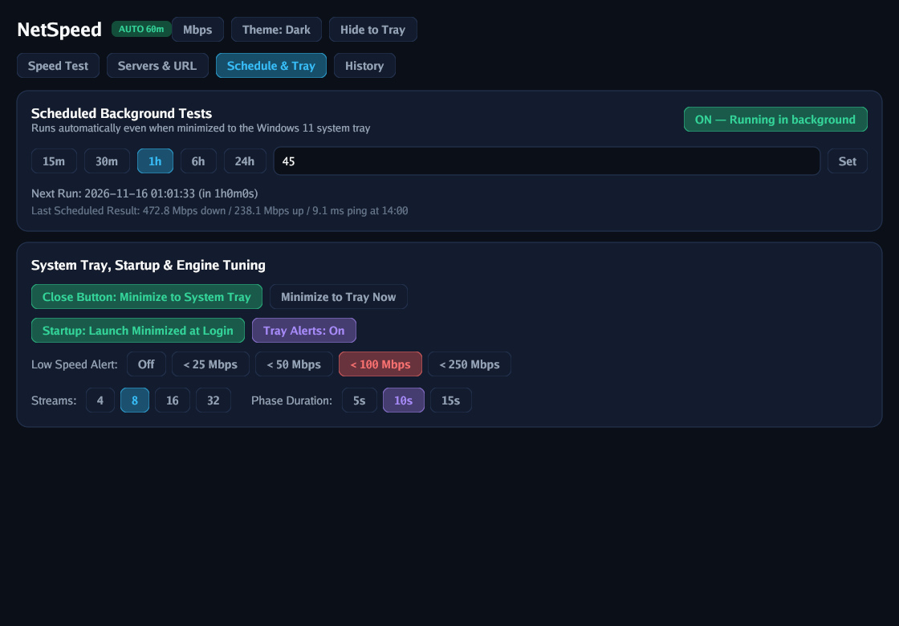
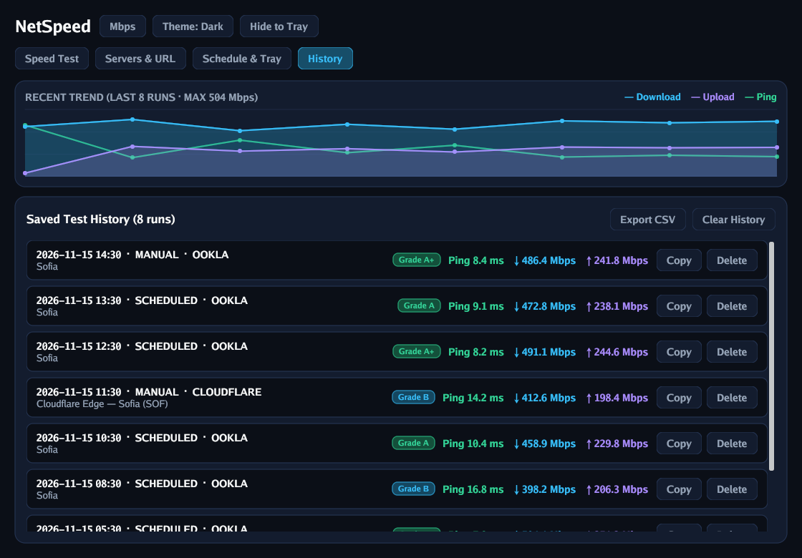

# NetSpeed & NetSpeed CLI

Minimalist Windows 11 internet speed test desktop application (`netspeed.exe`) and command-line tool (`netspeed-cli.exe`) built in **pure Go** with a shared multi-provider measurement engine and **Gio UI (`gioui.org`)** GPU-accelerated rendering.

## Screenshots

| Dark Dashboard (Completed Test & Grade A+) | Light Dashboard (Live Download Phase) |
| :---: | :---: |
| [](docs/screenshots/01-dashboard-dark.png) | [](docs/screenshots/02-dashboard-light.png) |
| [01-dashboard-dark.png](docs/screenshots/01-dashboard-dark.png) | [02-dashboard-light.png](docs/screenshots/02-dashboard-light.png) |

| Servers & Custom Endpoint URL | Scheduled Tests, System Tray & Tuning |
| :---: | :---: |
| [](docs/screenshots/03-servers-custom-url.png) | [](docs/screenshots/04-schedule-system-tray.png) |
| [03-servers-custom-url.png](docs/screenshots/03-servers-custom-url.png) | [04-schedule-system-tray.png](docs/screenshots/04-schedule-system-tray.png) |

| History & Multi-Metric Trend Graph | Shareable Result PNG Card Export |
| :---: | :---: |
| [](docs/screenshots/05-history-trends.png) | [](docs/screenshots/06-result-card-export.png) |
| [05-history-trends.png](docs/screenshots/05-history-trends.png) | [06-result-card-export.png](docs/screenshots/06-result-card-export.png) |

## Features

- **Speedtest.net (Ookla) & Cloudflare Providers**: Discovers ISP, public IP, and nearby servers, probes latency concurrently, and automatically falls back to Cloudflare Edge if Ookla endpoints are unavailable.
- **Custom Server URL Support**: Point either the GUI or CLI (`--url`) at any HTTP/HTTPS speed test endpoint or custom Ookla server URL (`/upload.php`).
- **Complete Metrics**:
  - Idle Ping, RFC-style Jitter (`ms`), and **Packet Loss (`%`)**
  - Loaded Download & Upload Ping with **Bufferbloat Quality Grade (`A+`–`F`)**
  - Multi-threaded Download & Upload Throughput (`Mbps`, `MB/s`, `Kbps`) using Ookla-style slow-start trimming and trimmed-mean aggregation
  - Live EMA-smoothed throughput curves
- **Pure Go GPU Desktop GUI (`netspeed.exe`)**:
  - Minimalist Dark & Light themes with native Windows 11 DWM titlebar synchronization (`dwmapi.dll`)
  - Custom 240° GPU vector speedometer gauge & live area sparklines
  - Session-aware **Copy Result** (Win32 UTF-16 clipboard) & **Save Card PNG** shareable dark/light image export
  - Windows 11 **System Tray Mode** (`Shell_NotifyIconW`) with minimize/close-to-tray, live speed tooltip, **Launch at Windows Login**, and **Tray Balloon Alerts** (scheduled completions & low-speed threshold alerts)
  - **Scheduled Background Tests** (`15m`, `30m`, `1h`, `6h`, `24h`, or custom minutes) with live countdown that continue running while minimized to tray
  - Shared test history with **Recent Trend Graph**, per-entry Copy/Delete actions, and CSV export
- **Command-Line Tool (`netspeed-cli.exe`)**:
  - Live ANSI terminal progress bar & sparkline
  - Machine-readable `--json` and `--csv` outputs (for speed runs, `--history`, and `--list`), plus `--simple`
  - Built-in `--schedule <duration>` loop and `--history` viewer shared with the GUI

## Repository Structure

```text
cmd/
  netspeed/       # Pure Go GPU desktop GUI (Gio + Win32 DWM + System Tray)
  netspeed-cli/   # Interactive & scriptable CLI binary
internal/
  engine/         # Ookla, Cloudflare, and Custom URL speed test engine
  config/         # Persistent settings (%AppData%\NetSpeed\config.json)
  history/        # Shared test history (%AppData%\NetSpeed\history.json)
  scheduler/      # Background periodic test scheduler
```

## Build & Run

```powershell
# Run tests and build both binaries into .\bin\
.\build.ps1
```

### CLI Usage

```powershell
# Interactive speed test (Auto: Ookla with Cloudflare fallback)
.\bin\netspeed-cli.exe

# List nearest servers
.\bin\netspeed-cli.exe --list

# Run against Cloudflare or a specific server ID
.\bin\netspeed-cli.exe --provider cloudflare
.\bin\netspeed-cli.exe --server 12345

# Test against a custom server URL
.\bin\netspeed-cli.exe --url https://speed.cloudflare.com

# Machine-readable outputs
.\bin\netspeed-cli.exe --json
.\bin\netspeed-cli.exe --csv --csv-header
.\bin\netspeed-cli.exe --simple

# View, export, or clear shared GUI/CLI test history
.\bin\netspeed-cli.exe --history
.\bin\netspeed-cli.exe --history --json
.\bin\netspeed-cli.exe --history --csv
.\bin\netspeed-cli.exe --list --json
.\bin\netspeed-cli.exe --clear-history

# Scheduled continuous CLI mode
.\bin\netspeed-cli.exe --schedule 30m
```

### GUI Usage

Launch `.\bin\netspeed.exe` (or `.\bin\netspeed.exe --minimized` to start directly in the Windows 11 system tray).
