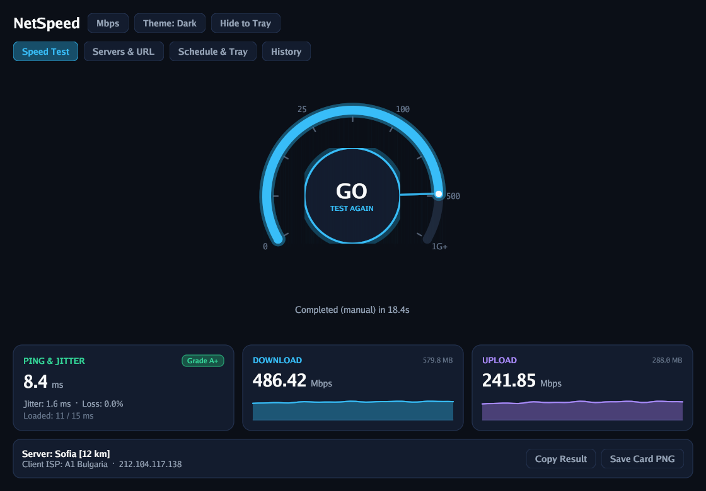
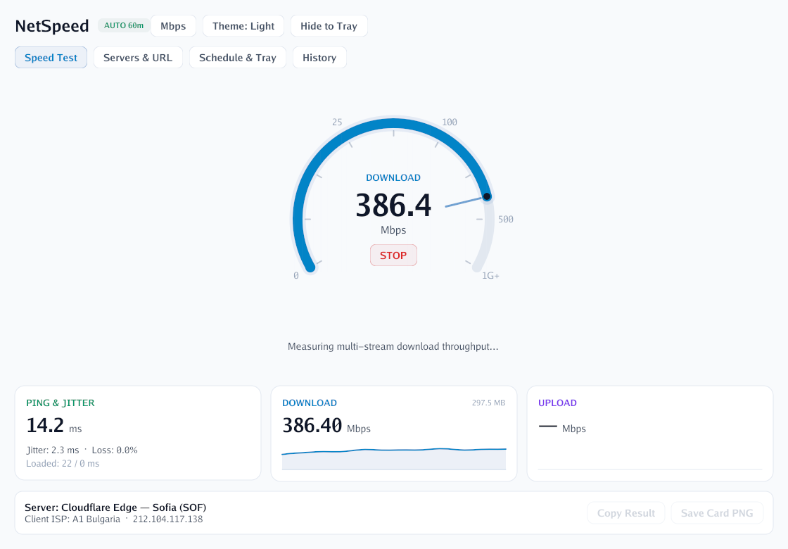
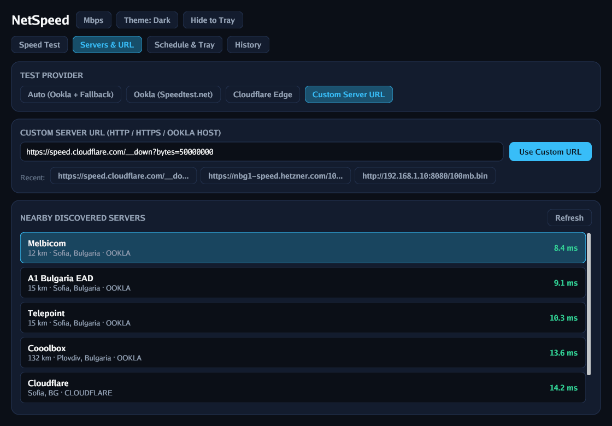
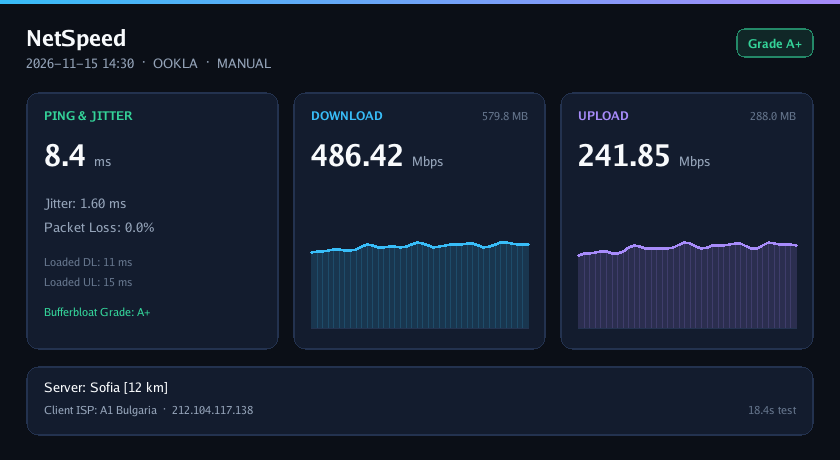

# NetSpeed & NetSpeed CLI

Minimalist Windows 11 internet speed test desktop application (`netspeed.exe`), **Raspberry Pi OS web application (`netspeed-web`)**, and cross-platform command-line tool (`netspeed-cli`) built in **pure Go** with a shared multi-provider measurement engine.

## Screenshots

| Dark Dashboard (Completed Test & Grade A+) | Light Dashboard (Live Download Phase) |
| :---: | :---: |
| [](docs/screenshots/01-dashboard-dark.png) | [](docs/screenshots/02-dashboard-light.png) |
| [01-dashboard-dark.png](docs/screenshots/01-dashboard-dark.png) | [02-dashboard-light.png](docs/screenshots/02-dashboard-light.png) |

| Servers & Custom Endpoint URL | Scheduled Tests, System Tray & Tuning |
| :---: | :---: |
| [](docs/screenshots/03-servers-custom-url.png) | [](docs/screenshots/04-schedule-system-tray.png) |
| [03-servers-custom-url.png](docs/screenshots/03-servers-custom-url.png) | [04-schedule-system-tray.png](docs/screenshots/04-schedule-system-tray.png) |

| History & Multi-Metric Trend Graph | Shareable Result PNG Card Export |
| :---: | :---: |
| [](docs/screenshots/05-history-trends.png) | [](docs/screenshots/06-result-card-export.png) |
| [05-history-trends.png](docs/screenshots/05-history-trends.png) | [06-result-card-export.png](docs/screenshots/06-result-card-export.png) |

## Features

- **Speedtest.net (Ookla) & Cloudflare Providers**: Discovers ISP, public IP, and nearby servers, probes latency concurrently, and automatically falls back to Cloudflare Edge if Ookla endpoints are unavailable.
- **Custom Server URL Support**: Point either the GUI or CLI (`--url`) at any HTTP/HTTPS speed test endpoint or custom Ookla server URL (`/upload.php`).
- **Complete Metrics**:
  - Idle Ping, RFC-style Jitter (`ms`), and **Packet Loss (`%`)**
  - Loaded Download & Upload Ping with **Bufferbloat Quality Grade (`A+`–`F`)**
  - Multi-threaded Download & Upload Throughput (`Mbps`, `MB/s`, `Kbps`) using Ookla-style slow-start trimming and trimmed-mean aggregation
  - Live EMA-smoothed throughput curves
- **Pure Go GPU Desktop GUI (`netspeed.exe`)**:
  - Minimalist Dark & Light themes with native Windows 11 DWM titlebar synchronization (`dwmapi.dll`)
  - Custom 240° GPU vector speedometer gauge & live area sparklines
  - Session-aware **Copy Result** (Win32 UTF-16 clipboard) & **Save Card PNG** shareable dark/light image export
  - Windows 11 **System Tray Mode** (`Shell_NotifyIconW`) with minimize/close-to-tray, live speed tooltip, **Launch at Windows Login**, and **Tray Balloon Alerts** (scheduled completions & low-speed threshold alerts)
  - **Scheduled Background Tests** (`15m`, `30m`, `1h`, `6h`, `24h`, or custom minutes) with live countdown that continue running while minimized to tray
  - Shared test history with **Recent Trend Graph**, per-entry Copy/Delete actions, and CSV export
- **Web Application & Server for Raspberry Pi OS (`netspeed-web`)**:
  - Single self-contained pure-Go binary (`CGO_ENABLED=0`) embedding the responsive Dark/Light Web UI (no Node.js, Python, or external CDN required)
  - Targets **Raspberry Pi 3B+**, **Raspberry Pi 4**, and **Raspberry Pi 5** on both **64-bit (`arm64`)** and **32-bit (`armv7`)** Raspberry Pi OS
  - Live Server-Sent Events (`/api/events`) dashboard with 240° animated gauge, Sparklines, Bufferbloat Grade, Copy Result (including plain-HTTP LAN clipboard support), and downloadable `840x460` PNG Result Cards (`/api/card`)
  - Background scheduler, optional browser Web Alerts + Low Speed threshold, systemd user-service autostart toggle (`Launch Server at Boot`), server selector, custom URL endpoints, trend graph, and CSV/JSON history exports
- **Command-Line Tool (`netspeed-cli` / `netspeed-cli.exe`)**:
  - Live ANSI terminal progress bar & sparkline
  - Machine-readable `--json` and `--csv` outputs (for speed runs, `--history`, and `--list`), plus `--simple`
  - Built-in `--schedule <duration>` loop and `--history` viewer shared with the GUI / Web App

## Repository Structure

```text
cmd/
  netspeed/       # Windows pure Go GPU desktop GUI (Gio + Win32 DWM + System Tray)
  netspeed-web/   # Cross-platform / Raspberry Pi HTTP server + embedded SPA web UI
  netspeed-cli/   # Interactive & scriptable CLI binary (Windows + Linux/Pi)
internal/
  engine/         # Ookla, Cloudflare, and Custom URL speed test engine
  card/           # Shared 840x460 PNG result card renderer & text summary formatter
  config/         # Persistent settings (%AppData%\NetSpeed or ~/.config/NetSpeed)
  history/        # Shared test history (history.json + CSV/JSON exports)
  scheduler/      # Background periodic test scheduler
```

## Build & Run

### Windows 11

```powershell
# Run tests and build netspeed.exe, netspeed-web.exe, and netspeed-cli.exe into .\bin\
.\build.ps1
```

### Raspberry Pi OS (Pi 3B+ / Pi 4 / Pi 5)

`build-pi.sh` checks whether Go is installed, optionally downloads/installs Go for your Raspberry Pi architecture (or falls back to `apt-get install golang`), runs the test suite, and builds zero-CGo binaries for `arm64` (64-bit OS) and `armv7` (32-bit OS):

```bash
chmod +x build-pi.sh

# Auto-detect Raspberry Pi architecture (prompts to install Go if missing)
./build-pi.sh

# Non-interactive install of Go if missing + build for this Raspberry Pi
./build-pi.sh --install-go --target native

# Cross-compile for both 64-bit (Pi 3B+/4/5) and 32-bit (Pi 3B+/4) Raspberry Pi OS
./build-pi.sh --target all
```

Start the embedded Web Server on your Raspberry Pi (accessible from any device on your LAN at `http://<pi-ip>:8080`):

```bash
./bin/netspeed-web -addr :8080

# Or verify health non-interactively
./bin/netspeed-web --smoke-test
```

### CLI Usage

```powershell
# Interactive speed test (Auto: Ookla with Cloudflare fallback)
.\bin\netspeed-cli.exe

# List nearest servers
.\bin\netspeed-cli.exe --list

# Run against Cloudflare or a specific server ID
.\bin\netspeed-cli.exe --provider cloudflare
.\bin\netspeed-cli.exe --server 12345

# Test against a custom server URL
.\bin\netspeed-cli.exe --url https://speed.cloudflare.com

# Machine-readable outputs
.\bin\netspeed-cli.exe --json
.\bin\netspeed-cli.exe --csv --csv-header
.\bin\netspeed-cli.exe --simple

# View, export, or clear shared GUI/CLI test history
.\bin\netspeed-cli.exe --history
.\bin\netspeed-cli.exe --history --json
.\bin\netspeed-cli.exe --history --csv
.\bin\netspeed-cli.exe --list --json
.\bin\netspeed-cli.exe --clear-history

# Scheduled continuous CLI mode
.\bin\netspeed-cli.exe --schedule 30m
```

### GUI Usage

Launch `.\bin\netspeed.exe` (or `.\bin\netspeed.exe --minimized` to start directly in the Windows 11 system tray).
